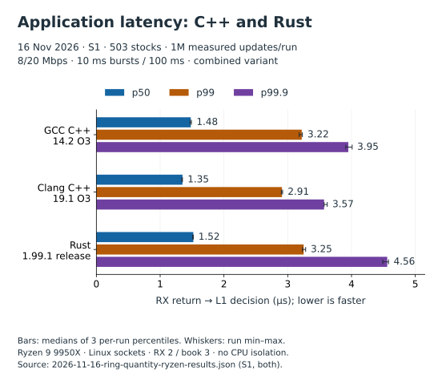
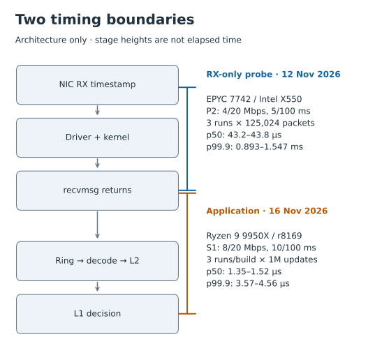
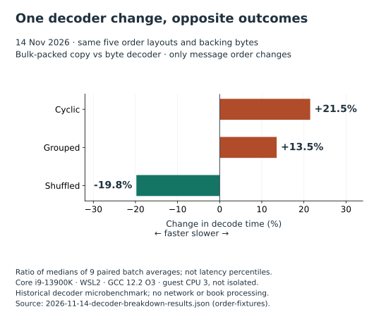

# Low-Latency Hands-On

A C++20 and Rust market-data receiver, with repeatable experiments in latency,
correctness and systems performance. It consumes exchange-style messages about
orders and trades, maintains an in-memory order book, and produces the latest
bid, ask and last-trade state.

Low latency keeps that view fresh. Predictable latency matters because occasional
slow updates can leave a consumer behind during bursts, even when the average
looks good. This project measures both typical updates and the slower tail,
while checking that the resulting market state is correct.

**Latest measured combined variant, 16 November 2026:** across three builds and
two 503-stock workloads, median per-run p50 was **1.35–1.52 µs** and p99.9 was
**3.57–4.56 µs**, with one million measured updates per run and no detected loss.
Within a run, p50 is the median and p99.9 covers 99.9% of sampled updates.
These are application timings, starting after socket reception and ending at
the decision to emit or suppress an L1 update (best bid, best ask and last trade).
NIC-to-L1 latency and maximum
throughput remain unmeasured. [Results and controls](benchmark/README.md#native-ring-and-quantity-comparison-2026-11-16).

The main findings: placement and measurement boundaries matter; decoder gains
can reverse with message order; and combining two optimizations need not retain
the benefit of either one. Correctness checks and negative results accompany
the performance claims.

[Run locally](#build-and-run) · [Measurements](#measured-application-latency) ·
[Experiments](docs/experiments/README.md) · [AI-assisted development](#ai-assisted-development) ·
[External comparisons](docs/comparisons.md)

## From feed to market state

**PITCH** is Cboe's binary market-data protocol. **L2**, or market depth,
aggregates outstanding buy and sell quantities at each price. **L1** summarizes
the best bid, best ask and last trade. **UDP multicast** sends a stream to a
network group that multiple receivers can subscribe to.

Three programs make the experiments repeatable:

1. `prepare_feed` creates a deterministic synthetic PITCH workload, a packet
   capture (PCAP) with scheduled send times, and an expected final L2 book.
2. `play_feed` preloads it and sends the packets over multicast. Delayed sends
   stretch the schedule; achieved rate and schedule slip are reported.
3. `processor_cpp` or `processor_rust` receives whole packets, decodes messages,
   updates L2/trades/metadata and decides whether L1 changed.

Both receivers use Linux sockets and two threads. A bounded
single-producer/single-consumer queue transfers packet ownership from reception
to one book-owning thread. Queue and timing storage are allocated before RX;
book-node allocations remain inside the timed work. Overflow drops the new
packet, preserving unread data. Benchmarks stop on loss. Independent wire
reconstruction checks final L1/L2 state and decision counts in the published matrices.

The receivers cover [U.S. equities multicast PITCH](docs/pitch-l1.md); the
synthetic generator exercises a smaller subset. Optional
[gap retransmission and snapshot recovery](docs/recovery.md) and a
[market monitor](monitoring/README.md) are implemented in both languages and
stay disabled in benchmark comparisons. Kernel bypass remains experimental:
[AF_XDP checks](docs/experiments/2026-11-13-xdp-rx-timing.md) yielded no latency
samples; DPDK is planned.

## Measured application latency

**p50** is the median; **p99** and **p99.9** are the times within which 99% and
99.9% of sampled updates finish. They describe the tail, not a worst-case bound.
Each run uses nearest-rank percentiles; summaries take the median of three
per-run percentiles, without pooling samples.



*16 November 2026, S1 combined variant. Bars show medians; whiskers show the full
three-run range. [JSON](docs/experiments/2026-11-16-ring-quantity-ryzen-results.json),
[CSV](docs/experiments/2026-11-16-ring-quantity-ryzen-results.csv).
Timing: `CLOCK_MONOTONIC` immediately after successful `recvmsg` return through
each message's L1 emit/no-update decision, including queue wait, decoding,
state updates and earlier messages in the same packet.*

The receiver was a Ryzen 9 9950X, Debian 13 / Linux 6.12.117, with 1 Gbps r8169
Ethernet; a separate EPYC 7742 sent the stream. RX CPU 2 and book CPU 3 share L3.
Affinity was verified, but cores were not isolated from OS work. Builds were
GCC 14.2 O3, Clang 19.1 O3 and Rust 1.99.1 release, without LTO or native target
flags. Containers and keyed hashing differ between languages, so this compares
implementations and toolchains rather than isolating a language effect.

Both profiles use seed 44, 503 symbols, 30,180 initialization adds and 1,000,000
measured updates. S1 uses 8 Mbps background / 20 Mbps peak, with 10 ms bursts
every 100 ms; S2 uses 25 ms every 250 ms. Rates count PITCH UDP payload bits.
The cycle average is 9.2 Mbps; this limited offered load does not establish
capacity. Activity is synthetic, not fitted to real exchange traffic.

The latest study validated 54 new trials covering ring-only, quantity-only and
combined changes, reusing 18 earlier controls after runtime-source checks.
The chart selects the combined variant implemented in current source. The
[earlier 503-stock table](docs/experiments/2026-11-16-sp500.md) is the pre-change
control. Historical L2-only timings use a different endpoint and stay separate.

## Where the receive time goes



*The [12 November RX-only probe](docs/experiments/2026-11-12-hardware-rx.md)
used an EPYC/X550 receiver and a different workload. Each of three captures
received all 125,024 packets. NIC-to-userspace p50 was 43.2–43.8 µs; p99.9 was
0.893–1.547 ms. PHC clock-read half-width reached 2.786 µs; physical-wire
calibration remains unverified. These per-packet percentiles cannot be added
to the Ryzen per-message application percentiles. No combined total was measured.*

## Experiments that changed the interpretation



*The [14 November decoder study](docs/experiments/2026-11-14-decoder-breakdown.md)
compares a bulk-copy packed decoder against a byte decoder, keeping the same
five order layouts and backing bytes. Values are changes in medians of nine
paired batch-average decode times, not message latency percentiles. This was
an i9-13900K / WSL2 / GCC 12.2 microbenchmark, not a network receiver result
or a measurement of today's zero-copy decoder. [JSON](docs/experiments/2026-11-14-decoder-breakdown-results.json).*

Message order alone changed packed decoding from 21.5% slower to 19.8% faster.
The full report retains near-parity cases, regressions and a separate diagnostic;
branch-prediction effects are an interpretation, without hardware-counter proof.

The [native ring/quantity study](benchmark/README.md#native-ring-and-quantity-comparison-2026-11-16)
found a small Rust quantity-only gain that did not survive combining the changes.
Its earlier controls were not interleaved with new trials, limiting interpretation
of small differences. [Affinity](docs/experiments/2026-11-12-cpu-affinity.md)
and [SipHash hardening](docs/experiments/2026-11-13-siphash.md) are earlier studies:
they inform design choices without supplying current-source latency claims.

[External references](docs/comparisons.md) include LMAX Disruptor, Aeron, DPDK
and published ITCH/order-book benchmarks. Their handoff, round-trip, forwarding
and batch-processing boundaries differ. No defensible direct latency comparison
was found; they inform architecture and experimental methods.

## AI-assisted development

Codex researched techniques, implemented changes, tested them and ran benchmarks;
the engineer directed scope and reviewed conclusions. This attribution is
maintainer-confirmed. The linked artifacts establish the experiments, rather
than independently documenting every human/agent interaction.

Two episodes show the division of work. The decoder investigation extended
paired tests, checked decoded fields and inspected compiler output; contradictory
ordering results prevented a blanket speedup claim. The ring/quantity study
measured each change separately and together, checked final state against wire
oracles, and retained mixed and negative outcomes. The engineer chose to reuse
the earlier validated controls, and that limitation stays explicit.

AI accelerated exploration and implementation; architecture, correctness and
interpretation remain the engineer's responsibility. [Evidence and attribution](docs/development.md).

## Build and run

Linux, CMake 3.20+, a C++20 compiler and Python 3 are sufficient for the core:

```sh
cmake -S . -B build -DCMAKE_BUILD_TYPE=Release
cmake --build build -j 4
ctest --test-dir build --output-on-failure
```

For Rust, install a toolchain and run `python3 benchmark/build_rust.py`.
Dependencies are pinned in `Cargo.lock`. [Usage](docs/usage.md) includes Rust tests
and a complete two-terminal loopback example. Network tests require multicast
sockets; offline-only tests use `ctest --test-dir build -LE network --output-on-failure`.
Run the network label separately where sockets are allowed.

[Workload recipes](simulator/play_files/README.md) reproduce synthetic fixtures.
Exact 503-stock bytes also require the original dated vendor input, which is
not distributed; a fresh download is a different input. Reviewed JSON/CSV
per-run results and hashes are published; raw captures and build snapshots are
not. [Benchmark prerequisites](benchmark/README.md), [source navigation](docs/structure.md)
and [figure regeneration](docs/images/README.md) provide the next steps.

[MIT license](LICENSE); SipHash-derived code retains its
[CC0 attribution](docs/licenses/SipHash-CC0.txt). The
[inspiring engineering article](https://deepengineering.net/p/from-nic-to-p99-engineering-low-latency)
guides experiments; its latency targets are not results of this project.
