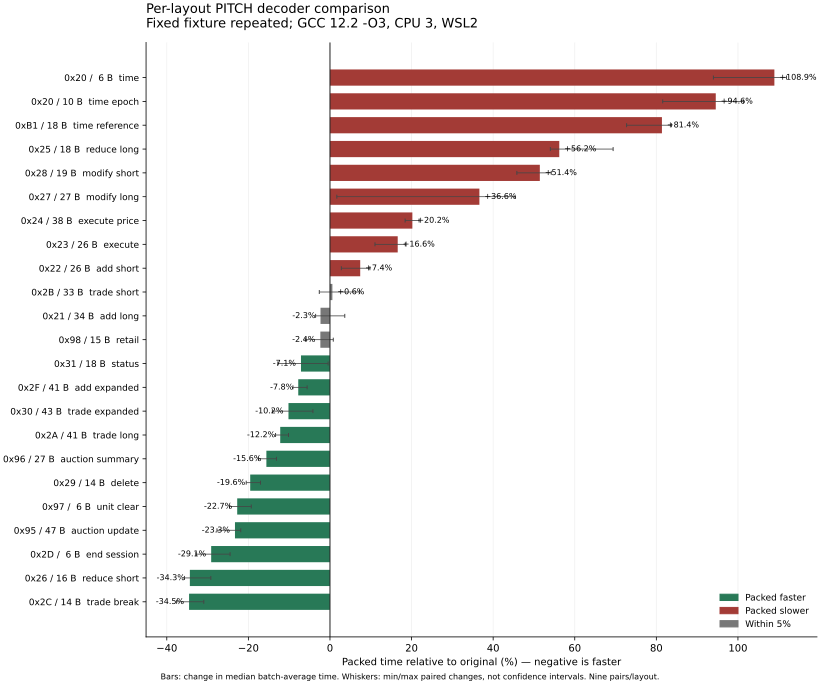

# PITCH decoder breakdown by layout and message order

Experiment date: 2026-11-14. The existing packed decoder has faster and slower
paths, and message ordering changes the aggregate result substantially. Repeated
single-layout tests show large regressions for Time, Time Reference, Reduce Long
and Modify; gains include Reduce Short, Delete, Trade Break and auction layouts.
A controlled diagnostic supports compiler-generated stack copies as a cause of
several regressions. Per-type averages alone do not predict mixed-feed cost.

The two project decoders are unchanged during this investigation. The benchmark
and its test/analysis tools were extended. The scalar-member diagnostic is a
separate generated binary, not an adopted processor decoder.

## Method and validation

Local Core i9-13900K, WSL2 Linux 6.6.87.2, GCC 12.2.0, C++20, Release `-O3
-DNDEBUG`, no LTO or `-march=native`. The decoder thread is pinned to guest CPU 3,
with its mask and each batch's start/end CPU verified inside the executable. The
launcher uses CPU 15. CPUs are not isolated from other work; guest affinity does
not reserve a physical Windows-host core. No remote deployment or host tuning
was performed. Actual flags, source/binary/input hashes and commands accompany
the raw results. Both decoder source hashes match the prior packed-decoder study.

Each condition has nine paired repetitions, minimum 5,000,000 decoder calls per
version per run, and minimum 100,000 warmup calls rounded up to whole-corpus
passes. Decoder order and condition order are shuffled deterministically using
seed 20261114. Batches include the same view construction, complete decoder
call and checksum work as the [earlier comparison](2026-11-14-packed-decoder.md).
`CLOCK_MONOTONIC` brackets the batch. Tables report medians of batch-average
ns/message, not per-message p50/p99 percentiles. Every input message is compared
field-for-field between decoders before timing, and every measured pair checks
matching output checksums.

The 40 main conditions are 23 isolated fixture layouts (including both Time
lengths), seven individually filtered PCAP types, and ten mixed/order controls.
Type/length selection keeps the original backing bytes and relative offsets.
`--copies` duplicates descriptors, not wire bytes; `--order` changes only the
reference order, with stable grouping by type/length or deterministic shuffling.
The base allocation modulo 64 and message-start alignment histograms are
recorded. For every matched input/grouped/shuffled triple, those histograms,
message counts and contents match; storage is at modulo-64 offset 16 in this run.

All 40 conditions and 14 diagnostic conditions succeeded, with no retries or
excluded pairs: **972 timed batches** total. All **10 CTest tests**, including
loopback multicast, passed. The new selector/order CLI tests passed under UBSan;
**28 Python benchmark-tool tests** passed. The diagnostic passed the same
**168,784-case** decoder differential test against the original byte decoder.
No tests/builds ran concurrently with timed batches. The local ASan limitation
from the earlier study remains; there is no new ASan claim.

## Isolated fixture layouts

Each row repeatedly decodes one fixed fabricated message at its original
position in the fixture backing buffer. This measures a predictable, hot path,
including dispatch. It does not measure that type inside an unpredictable mixed
stream. Percentages describe time, so positive means packed took longer.
“Packed faster pairs” preserves the direction across all nine pairs; a small
median difference with mixed pair directions is not a reliable universal win.

| Layout | Type / bytes | Original ns | Packed ns | Packed time change | Packed faster pairs |
| --- | --- | ---: | ---: | ---: | ---: |
| time | `0x20` / 6 | 2.912 | 6.083 | +108.9% | 0/9 |
| time epoch | `0x20` / 10 | 3.335 | 6.489 | +94.6% | 0/9 |
| add long | `0x21` / 34 | 10.025 | 9.792 | -2.3% | 7/9 |
| add short | `0x22` / 26 | 8.961 | 9.625 | +7.4% | 0/9 |
| execute | `0x23` / 26 | 5.427 | 6.328 | +16.6% | 0/9 |
| execute price | `0x24` / 38 | 6.484 | 7.794 | +20.2% | 0/9 |
| reduce long | `0x25` / 18 | 4.411 | 6.891 | +56.2% | 0/9 |
| reduce short | `0x26` / 16 | 4.264 | 2.799 | -34.3% | 9/9 |
| modify long | `0x27` / 27 | 5.358 | 7.321 | +36.6% | 0/9 |
| modify short | `0x28` / 19 | 4.651 | 7.044 | +51.4% | 0/9 |
| delete | `0x29` / 14 | 3.935 | 3.165 | -19.6% | 9/9 |
| trade long | `0x2A` / 41 | 10.752 | 9.441 | -12.2% | 9/9 |
| trade short | `0x2B` / 33 | 9.847 | 9.905 | +0.6% | 3/9 |
| trade break | `0x2C` / 14 | 3.994 | 2.615 | -34.5% | 9/9 |
| end session | `0x2D` / 6 | 3.375 | 2.392 | -29.1% | 9/9 |
| add expanded | `0x2F` / 41 | 10.902 | 10.055 | -7.8% | 9/9 |
| trade expanded | `0x30` / 43 | 11.590 | 10.411 | -10.2% | 9/9 |
| status | `0x31` / 18 | 11.508 | 10.691 | -7.1% | 9/9 |
| auction update | `0x95` / 47 | 10.441 | 8.010 | -23.3% | 9/9 |
| auction summary | `0x96` / 27 | 9.139 | 7.715 | -15.6% | 9/9 |
| unit clear | `0x97` / 6 | 3.196 | 2.469 | -22.7% | 9/9 |
| retail | `0x98` / 15 | 7.723 | 7.541 | -2.4% | 8/9 |
| time reference | `0xB1` / 18 | 4.035 | 7.319 | +81.4% | 0/9 |



The short/long distinction does not by itself predict the outcome. For example,
Reduce Short improves by 34%, while Reduce Long regresses by 56%. Add Long and
Retail are close to parity; Trade Short's +0.6% median also has mixed pair signs.
These percentages apply to this fixture/address/build, not every possible value,
alignment or compiler.

## Filtered types with real PCAP values

The version-2, seed-43 PCAP has 1,000,204 messages: 1,000,180 order messages,
23 Time messages and one Unit Clear. Each type is filtered without compacting
its backing bytes, retaining real generated values and varying message positions.
The backing allocation remains 24,667,328 bytes, while each selected active
working set differs. These conditions are not equivalent to the single fixed
fixture tests above.

| Type | PCAP share | Original ns | Packed ns | Packed time change | Packed faster pairs |
| --- | ---: | ---: | ---: | ---: | ---: |
| `0x20` | 0.0023% | 2.634 | 5.921 | +124.8% | 0/9 |
| `0x21` | 18.6436% | 13.239 | 12.514 | -5.5% | 7/9 |
| `0x23` | 24.6377% | 8.205 | 8.339 | +1.6% | 3/9 |
| `0x25` | 20.1721% | 6.854 | 8.103 | +18.2% | 1/9 |
| `0x27` | 24.3874% | 9.339 | 9.865 | +5.6% | 3/9 |
| `0x29` | 12.1568% | 7.405 | 6.133 | -17.2% | 9/9 |
| `0x97` | 0.0001% | 3.198 | 2.402 | -24.9% | 9/9 |

The major order types do not all improve in isolation. Delete has a consistent
gain; Add Long improves in seven of nine pairs. Execution and Modify Long are
close/noisy here, while Reduce Long is slower in eight of nine pairs. Time has a
large regression but is only 0.0023% of this PCAP. Several slower fixture-only
layouts do not occur in the generated PCAP at all.

## Same contents, different order

The tiny fixture backing buffer is 543 bytes. Repeating 23 messages 1,024 times
creates 23,552 descriptors, while all source bytes stay in the same tiny buffer.
The five-order subset uses Add Long, Executed, Reduce Long, Modify Long and
Delete equally, producing 5,120 descriptors. These controls make frequency,
source values, physical wire placement and active wire footprint equal within
each ordering triple. Descriptor traversal remains sequential. An ordering
change can affect branch history and instruction scheduling without introducing
a larger wire-data working set.

| Input / order | Original ns | Packed ns | Packed time change | Packed faster pairs |
| --- | ---: | ---: | ---: | ---: |
| 23 fixtures, cyclic | 6.484 | 6.654 | +2.6% | 1/9 |
| 23,552 fixtures, cyclic | 6.416 | 6.702 | +4.5% | 0/9 |
| 23,552 fixtures, grouped | 6.574 | 6.853 | +4.2% | 1/9 |
| 23,552 fixtures, shuffled | 15.486 | 12.087 | -22.0% | 9/9 |
| 5,120 order fixtures, cyclic | 5.489 | 6.669 | +21.5% | 0/9 |
| 5,120 order fixtures, grouped | 5.617 | 6.377 | +13.5% | 0/9 |
| 5,120 order fixtures, shuffled | 11.184 | 8.972 | -19.8% | 9/9 |
| PCAP, natural order | 10.966 | 9.178 | -16.3% | 9/9 |
| PCAP, grouped | 10.063 | 10.318 | +2.5% | 4/9 |
| PCAP, shuffled | 55.810 | 39.094 | -30.0% | 9/9 |

The same five order fixtures make packed 21.5% slower cyclically but 19.8%
faster shuffled. The all-layout fixture comparison likewise changes from 4.5%
slower to 22.0% faster. Message frequencies alone cannot explain those flips.
This is strong evidence of ordering-sensitive execution, consistent with branch
prediction/dispatch effects. Hardware counters were not collected (`perf` is
not installed), so the exact branch-misprediction or cycle contribution is not
established.

For the PCAP, grouping removes the consistent packed advantage: the median is
2.5% slower with only four of nine pairs favoring packed, compared with a 16.3%
advantage in natural order and nine of nine favorable pairs. Shuffling the large
PCAP also changes data-access locality, so its much larger absolute times must
not be attributed solely to branch prediction.

A frequency-weighted combination of isolated PCAP medians gives 9.050 ns for
original and 9.174 ns for packed, whereas natural mixed order measures 10.966
and 9.178 ns. That weighted calculation is descriptive, not a performance
prediction: it ignores order and working-set interactions. Its failure to
reproduce the mixed result shows why selecting a decoder from per-type rankings
alone would be unsafe. Absolute numbers also differ from earlier binary layouts;
comparisons here are within the same current binary and condition.

## Compiler-generated temporary copies

Disassembly explains a concrete regression candidate. The generic packed loader
checks length and `memcpy`s the complete prefix into a local packed object.
GCC inlines the copy, but does not consistently eliminate that object. For the
six-byte Time structure, the observed instructions are equivalent to:

```asm
mov ecx, DWORD PTR [source]       ; copy bytes 0..3
mov DWORD PTR [temporary], ecx
movzx ecx, WORD PTR [source+4]    ; copy bytes 4..5
mov WORD PTR [temporary+4], cx
mov ecx, DWORD PTR [temporary+2]  ; seconds crosses those two stores
```

Reduce Long's 18-byte prefix similarly becomes a 16-byte store and a two-byte
store, followed by a four-byte quantity read at offset 14 across their boundary.
Reduce Short's 16-byte prefix is handled through registers and does not need
that particular stack-copy/reload pattern. Several Modify/execution paths also
have overlapping bulk stores and subsequent scalar reloads.

Intel describes size/overlap restrictions on forwarding recent stores to loads
in its [Optimization Reference Manual, section 3.6.4.1](https://cdrdv2-public.intel.com/821612/248966-Optimization-Reference-Manual-V1-050.pdf).
Loads spanning separately stored chunks can incur additional latency. The
observed patterns are consistent with such penalties; the exact blocked-load
count is not measured on this guest/CPU. Inlining `memcpy` therefore does not
prove the copy has disappeared. The little-endian `from_le` identity helper is
still optimized away and is not the source of these stack reloads.

## Controlled scalar-member diagnostic

A separate generated decoder preserves the packed type declarations, named
members, prefix checks, endian conversion, dispatch and validation. Only the
load specializations for Time/TimeEpoch, Time Reference, Executed/ExecutedPrice,
Reduce Long and both Modify forms change: consumed scalar members are copied
individually using fixed-size `memcpy` with `offsetof`-derived locations. Unused
wire members are zero initialized. The compiler can retain the consumed values
in registers instead of materializing a whole wire object through partial stores.
No packet pointer is cast to a packed struct and no production decoder is edited.

The [diagnostic patch](2026-11-14-decoder-scalar-diagnostic.patch) records the exact
changes. It exposes a separate experimental symbol, requires a forward
declaration in the standalone driver, and is not applied to the project source.
The generated differential test compares all decoded fields/errors against the
original byte implementation; all 168,784 cases passed. A separate paired
benchmark compares unchanged bulk-packed versus scalar-member-packed in the
same diagnostic executable, with the same compiler/settings and CPU checks.
These absolute times must not be pooled with the main binary's numbers.

| Diagnostic condition | Bulk-packed ns | Scalar-member ns | Scalar time change |
| --- | ---: | ---: | ---: |
| delete | 2.657 | 2.636 | -0.8% |
| execute | 6.854 | 3.139 | -54.2% |
| execute price | 8.180 | 3.542 | -56.7% |
| fixtures-input | 7.003 | 5.537 | -20.9% |
| fixtures-shuffled | 11.950 | 12.078 | +1.1% |
| modify long | 6.902 | 2.998 | -56.6% |
| modify short | 7.133 | 3.398 | -52.4% |
| pcap-input | 8.752 | 8.402 | -4.0% |
| reduce long | 6.322 | 2.557 | -59.5% |
| reduce short | 3.164 | 3.164 | +0.0% |
| time | 6.723 | 2.985 | -55.6% |
| time epoch | 6.491 | 2.658 | -59.1% |
| time reference | 6.692 | 2.782 | -58.4% |
| unit clear | 2.393 | 2.397 | +0.2% |

The targeted predictable paths improve by about 52–60%. Unchanged Delete,
Unit Clear and Reduce Short controls remain within 1%. The Time diagnostic now
has a direct four-byte source load rather than the partial-store/reload sequence.
This controlled change supports the temporary-copy explanation, though it also
changes compiler register allocation/layout and does not uniquely count store-
forwarding stalls.

The mixed diagnostic result is much smaller: natural PCAP improves by 4.0%,
cyclic fixtures by 20.9%, and shuffled fixtures are 1.1% slower. Removing a local
path bottleneck does not guarantee the same gain in every mixed workload.
The practical optimization candidate is to preserve named wire layouts while
avoiding whole-prefix temporaries on affected paths, then verify the complete
RX-to-L1 processor path before any adoption. This investigation does not select
or deploy a replacement decoder.

## Reproduce and evidence

```sh
cmake -S . -B build -DCMAKE_BUILD_TYPE=Release -DCMAKE_EXPORT_COMPILE_COMMANDS=ON
cmake --build build -j --target pitch_decode_bench
python3 benchmark/run_decode_breakdown.py \
  --pcap simulator/play_files/pitch-v2-1m-base8m-peak20m-b10ms-e100ms_sym3_seed43.pcap \
  --output analysis/decoder-breakdown-new
```

The output directory must be fresh; failed conditions are retained, not retried,
and make the runner return failure. The default PCAP type list matches the
current generator; `--pcap-types` selects another known type set.
For individual conditions:

```sh
taskset -c 3 build/pitch_decode_bench \
  --fixtures processors/tests/equities_messages.tsv --type 0x25 --length 18

taskset -c 3 build/pitch_decode_bench \
  --fixtures processors/tests/equities_messages.tsv --copies 1024 --order shuffled

taskset -c 3 build/pitch_decode_bench \
  --pcap simulator/play_files/pitch-v2-1m-base8m-peak20m-b10ms-e100ms_sym3_seed43.pcap \
  --type 0x29
```

Portable [JSON](2026-11-14-decoder-breakdown-results.json),
[CSV](2026-11-14-decoder-breakdown-results.csv) and the figure retain summaries
and all paired averages, including mixed/near-parity cases. Main raw outputs,
commands, inventories, source snapshots and disassembly are preserved under
`analysis/2026-11-14-decoder-breakdown-001/`. The generated diagnostic source,
source-generation/build/run scripts, compiler commands, validation output,
paired raw reports and disassembly are under
`analysis/2026-11-14-decoder-breakdown-scalar-001/`. There are 720 main and 252
diagnostic timed batches. All data is fabricated or from the existing synthetic
workload; no purchased source data was used.
