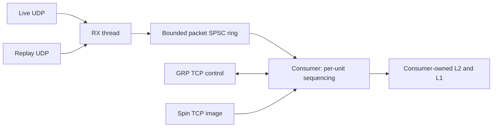

# PITCH gap and spin recovery

The project is a learning implementation of low-latency U.S. equities PITCH
processing in C++ and Rust. Recovery
uses Cboe wire protocols and fabricated workloads. There are no exchange captures
or live-exchange interoperability results.

Protocol authority: [Cboe U.S. Equities/Options Multicast PITCH specification](https://www.cboe.com/document/tech-spec/document/technical-specifications/cboe-titanium-u.s.-equitiesoptions-multicast-pitch-specification),
particularly Sequenced Unit Header, GRP messages, Spin Messages, and the spin
usage/rollover examples. The [GRP description](https://www.cboe.com/document/tech-spec/content/technical-specifications/cboe-titanium-u.s.-equitiesoptions-multicast-pitch-specification/introduction/gap-request-proxy-and-message-retransmission),
[spin description](https://www.cboe.com/document/tech-spec/content/technical-specifications/cboe-titanium-u.s.-equitiesoptions-multicast-pitch-specification/introduction/spin-servers),
and [equities production limits](https://www.cboe.com/document/tech-spec/content/technical-specifications/cboe-titanium-u.s.-equitiesoptions-multicast-pitch-specification/multicast-configuration/us-equities-production-environment-configuration/limitationsconfigurations)
are the other protocol references. Checked 2026-11-15. Options and other regional
PITCH variants are outside scope. Client buffering and checkpoint choices below
are project decisions, not Cboe requirements.

## Run a local recovery experiment

Build with the root CMake commands. Supply login fields in **both terminals**:

```sh
export PITCH_SESSION=0001
export PITCH_USERNAME=TEST
export PITCH_PASSWORD=lab
```

These are fabricated laboratory credentials. Real credentials must stay outside
source control and reports. Fields are space-padded to 4, 4 and 10 bytes.

Prepare a deterministic workload in an unused directory:

```sh
build/prepare_feed --directory /tmp/pitch-recovery-demo --messages 100000 \
  --background-mbps 8 --burst-mbps 8 --burst-ms 0
```

Start the simulator, then the processor in the other terminal before the start
delay expires. Use the exact PCAP path printed by the preparer:

```sh
build/serve_feed /tmp/pitch-recovery-demo/pitch-v2-100k-base8m-peak8m-b0ms-e100ms_sym3_seed42.pcap \
  --start-delay-ms 10000 --drop-packets 40-65
```

```sh
build/processor_cpp --continuous --grp 127.0.0.1:30003 \
  --spin-server 127.0.0.1:30004 --gap-group 239.255.0.2 --gap-port 30002 \
  --messages 100000 --output /tmp/pitch-recovery-cpp.json
```

Use `build/rust-o3/processor_rust` with identical options after building with
`python3 benchmark/build_rust.py`. Reports are written on shutdown; interrupt the
processor after `stream_finished` and recovery catch-up, then stop the simulator.
Choose a new report path for another run. Recovery currently requires continuous
mode; the default stop-on-loss benchmark remains available without `--grp`.

Add `--reject-grp` to the simulator to exercise spin fallback. Other deterministic
fault controls are `--replay-before-ack`, `--drop-replay-once`, and
`--tcp-fragment-bytes 1`. `--drop-packets` accepts 1-based datagram indices/ranges;
it omits delivery while preserving the simulated exchange's message history.

## State and ownership



Both processors keep two threads. In recovery mode RX polls the live and replay
sockets, alternates when both are ready, and carries channel identity and the
immediate post-`recvmsg` timestamp through the existing ring. Whole datagrams are
still dropped when that ring fills; no unread slot is overwritten.

The consumer owns TCP recovery sessions, the reorder buffer, and all book state.
TCP operations are nonblocking after a bounded startup connect. Control sessions
are serviced at most once per 100 microseconds outside the message timing
endpoint. This polling interval is a responsiveness/CPU tradeoff, not a measured
optimum. It does add work to the consumer; recovery-mode throughput has not been
qualified against the baseline. There is no extra thread mutating the book.

In-order live datagrams use the original whole-packet processor path. On a gap,
the consumer holds the last contiguous state, marks quotes stale, and copies
later messages into a preallocated circular buffer. Slot positions use modular
**message distance** from the next expected sequence. This works across
`UINT32_MAX -> 1`; using `sequence % capacity` directly would alias slots at that
boundary. Stale messages are skipped. Conflicting duplicates still in the buffer
are fatal. An overlapping packet's unseen suffix can be applied once.

One GRP request is outstanding at a time. Requests contain up to 100 missing
messages. The TCP acknowledgment and UDP replay are tracked independently;
replay can precede the acknowledgment. Incoming live traffic continues while
waiting. Conservative rolling windows cap requests at 320/second and
1500/minute; a session lifetime cap of 100000 is stricter than resetting a daily
allowance. The simulator enforces these laboratory limits too.

`--recovery-max-gap` (10000) compares newly discovered missing ranges, not the
growing backlog behind an earlier gap. Larger holes, rejects, a request timeout,
or exhaustion of the reorder window select spin when configured. There are no
hidden GRP retries. A missing fallback, TCP session failure, malformed input,
spin rejection/timeout, or another buffer exhaustion during spin terminates
ingestion. Fatal input requires downstream invalidation, as in the baseline.

## Spin and validity

A mid-session join also selects spin. The client waits for an advertised image
whose boundary covers the missing prefix, requests it, validates the response
and advertised Add count, and buffers live multicast throughout. Snapshot
construction does not publish intermediate quotes. At `Spin Finished`, it applies
the buffered suffix strictly after the image boundary, filling further gaps
through GRP if needed. Quotes become current only after contiguous catch-up.

Before replacing a book, callbacks invalidate and clear every previously retained
symbol, including symbols absent from the new image. Fresh image symbols are
published stale, followed by the current transition after catch-up. Resource
limits apply during image construction too.

Successful GRP replay preserves complete execution history if it was complete
before the gap: no later executions were applied out of order. During the hold,
`book_current=false` signals staleness; trade-history continuity refers to the
retained contiguous prefix. Spin rebuilds orders and documented symbol metadata,
clears old last trades, and sets `trade_history_current=false`. It cannot supply
missing executions or support an assertion of complete historical rollback.
Subsequent observed executions can supply a last, while history stays incomplete.

Recovery never erases run loss history. Continuous reports remain
`benchmark_valid=false`. `recovery` reports request/rejection counts, replayed
messages, duplicate messages, spins, timeouts, buffer overflows, buffer high-water
mark and completion durations from observation to contiguous catch-up. Buffered
and replayed messages make L1 decisions but do **not** enter ordinary RX-to-L1
latency percentiles. Snapshot population is excluded as well. Normal live samples
resume after catch-up. These durations are local processing/recovery intervals,
not cross-host one-way or NIC latency.

## Simulator archive and fast image construction

`serve_feed` is separate from the unchanged `play_feed` replayer. It preloads and
validates the full PCAP before READY, builds a message-sequence index, and stores
full open-order/metadata checkpoints every `--checkpoint-messages` messages
(4096 by default). The input must be a complete single-unit equities stream
starting at sequence 1 and initializing orders with Unit Clear. It rejects
missing order references and quantity overdraws when indexing. Repeated sequence
epochs in one archive are rejected. The processors themselves handle rollover.

The sender uses preloaded packets and scheduled relative times. It performs no
snapshot construction, parsing, allocations, or file I/O in the send loop and
shifts late deadlines to avoid catch-up bursts. A published archive position
tracks how far the simulated exchange has advanced, even for injected drops.
The service will not replay future messages. After the file ends, sequenced live
heartbeats continue so a lost tail can still be detected. The completion line
records actual elapsed time, injected drops and schedule slip.

Recovery workers read the immutable archive concurrently with the sender. GRP
retrieves original message bytes directly by sequence, then repacks them within
the UDP payload limit. It waits 2 ms before replay. The simulator has one active
login per service and bounds concurrent connections. It does not aggregate
overlapping requests from multiple subscribers into a shared replay response.

For any requested message boundary, `RecoveryArchive::snapshot` copies the
nearest earlier checkpoint and replays fewer than 4096 subsequent messages.
`through_time` maps a PCAP relative time to its completed-packet boundary. Image
construction costs **O(checkpoint book copy + bounded replay + image output)**;
there is no constant-time promise for a full book. More frequent checkpoints
use more memory. The archive also holds both packets and message bytes, so memory
use is larger than the PCAP alone. Snapshot orders use canonical expanded Adds,
retaining normalized price/size, flags, attribution and customer fields; clock
contexts and documented symbol metadata accompany them. Snapshot generation
does not invent execution history.

The network service advertises an available boundary once per second and retains
the last ten advertisements. It chooses the documented matching/next boundary
for spin requests. The archive API can reconstruct arbitrary boundaries for
testing; the wire service still follows Cboe image advertisement semantics.

## Verification

```sh
ctest --test-dir build --output-on-failure
CARGO_TARGET_DIR="$PWD/build/rust-tests" cargo test --manifest-path processors/rust/Cargo.toml --locked
python3 processors/tests/test_recovery.py build/rust-o3/processor_rust build/prepare_feed build/serve_feed
```

The C++ archive test compares images at every boundary of a fabricated stream
with independent full replay, across many checkpoints and clock changes. The
shared network suite compares 100000-update recovery runs against loss-free
L1 and manifest L2, covering fragmented TCP, replay-before-ack, GRP rejection,
lost replay, spin joins, large gaps, lost tails and bounded-buffer failure. An independent scripted peer checks
overlapping packets, exactly-once executions, rollover and malformed TCP framing.
The existing baseline CLI/network tests remain separate.

See [Rust recovery implementation notes](rust-recovery.md) for ownership,
borrowing and error-handling details alongside the C++ equivalents.

Local verification on 2026-11-15:

| Check | Result |
| --- | --- |
| Release CMake build with project warning flags | Passed |
| Full CTest suite | 12 tests passed, including existing multicast regressions |
| Expanded shared recovery suite, C++ release | 12 scenarios passed |
| Expanded shared recovery suite, Rust release | Same 12 scenarios passed |
| Rust native suite with locked dependencies | 18 tests passed |
| Existing shared multicast suite, Rust release | Passed |
| Debug UBSan archive boundary/flag tests | Passed |
| Debug UBSan processor + simulator, shared recovery suite | 12 scenarios passed with halt-on-error |

The initial sandbox run could not create sockets. Local network suites were run
with loopback socket access; they were not inferred from offline checks. These
are fabricated-input correctness checks, not latency qualification or live-feed
certification. During implementation the delayed-replay check exposed a gap-size
threshold that incorrectly included the growing held backlog; the threshold now
uses newly missing ranges and the timeout scenario verifies that distinction.
